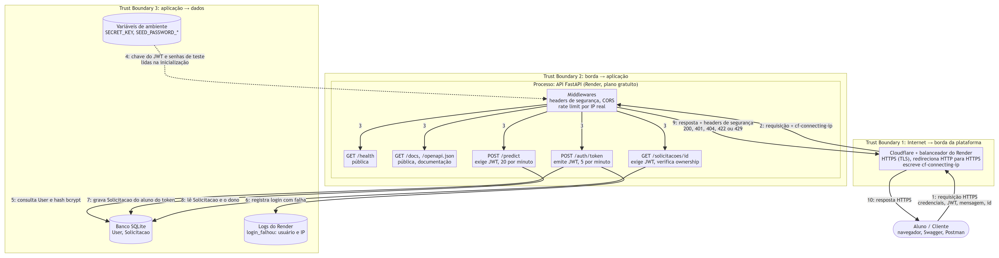
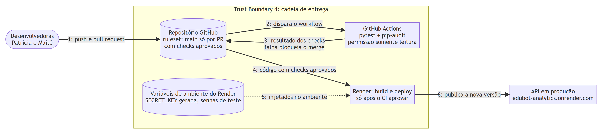

# EduBot Analytics - Suporte Acadêmico Universitário

## Sobre o projeto

Este repositório contém o desenvolvimento do projeto **EduBot Analytics**, um agente de IA para suporte acadêmico universitário, que atende pedidos de matrícula, trancamento de disciplinas e consulta de notas. Ele foi desenvolvido como parte da disciplina **Projeto de Bloco: Análise e Segurança de Agentes de IA**.

O projeto é construído ao longo do bloco em cinco entregas parciais, evoluindo desde a exploração de dados e o setup de uma API segura até a implementação de um agente de IA funcional e um pentest cruzado entre duplas.

- **Desafio de IA:** classificar a urgência do pedido do aluno e a sua categoria (burocrático ou pedagógico).
- **Desafio de segurança:** evitar que alunos manipulem o agente para alterar notas ou acessar registros de outros estudantes.

### Links rápidos

| | |
| --- | --- |
| **API publicada** | https://edubot-analytics.onrender.com |
| **Documentação da API (Swagger)** | https://edubot-analytics.onrender.com/docs |
| **Auditoria final de segurança (TP3)** | [`security/auditoria-final-tp3.md`](security/auditoria-final-tp3.md) |
| **Plano de escopo do pentest (TP4)** | [`security/plano-pentest.md`](security/plano-pentest.md) |
| **Modelagem de ameaças** | [DFD](dfd/dfd.md) · [Análise CIA](dfd/analise-cia.md) · [STRIDE](dfd/threat-model-stride.md) |
| **Relatórios de entrega** | [`entregas/`](entregas/) |

> A API está no plano gratuito do Render e "dorme" após 15 minutos sem uso. O primeiro acesso depois disso leva cerca de 50 segundos.

## Disciplina e equipe

| **Disciplina** | Projeto de Bloco: Análise e Segurança de Agentes de IA |
| --- | --- |
| **Professor(a)** | Ricardo Pires Mesquita |
| **Aluno A - Dados/IA** | Maitê Mota Belo de Souza Silva |
| **Aluno B - Infra/Sec** | Patricia Dias Rodrigues |

## Andamento por TP

| TP | Dados/IA | Infra/Sec | Onde está |
| --- | --- | --- | --- |
| **TP1** | Escolha do dataset, limpeza e EDA inicial | API FastAPI com JWT, DFD e análise CIA | `eda/eda_edubot_tp1.ipynb`, `eda/escolha-do-dataset.md`, `api/`, `dfd/` |
| **TP2** | Correlações, teste de hipótese e relatório de EDA | Controles OWASP Top 10, rate limiting, testes pytest e scan OWASP ZAP | `eda/eda_edubot_tp2.ipynb`, `eda/relatorio_eda_tp2.md`, `security/`, `entregas/TP2/` |
| **TP3** | Regressão linear e pergunta de classificação _(em andamento)_ | Auditoria final, 67 testes de segurança, GitHub Actions, OpenAPI documentado, deploy no Render, STRIDE e plano de pentest | `security/auditoria-final-tp3.md`, `.github/workflows/`, `dfd/`, `entregas/TP3/` |

## Estrutura do repositório

```
├── .github/workflows/
│   └── security-tests.yml        # CI: pytest + pip-audit a cada push e PR
├── api/                          # API FastAPI (Infra/Sec)
│   ├── app/                      # código da aplicação (detalhes abaixo)
│   ├── tests/                    # 67 testes de segurança (pytest)
│   ├── requirements.txt          # dependências fixadas e auditadas
│   ├── requirements-dev.txt      # pytest, httpx, black, pip-audit
│   ├── .env.example              # modelo das variáveis de ambiente
│   └── .python-version           # Python 3.12 (mesmo do CI e do Render)
├── dfd/                          # Modelagem de ameaças
│   ├── dfd.md                    # DFD v3 em Mermaid, entradas, saídas e trust boundaries
│   ├── dfd-v3-requisicao.png     # DFD: fluxo de uma requisição
│   ├── dfd-v3-cicd.png           # DFD: cadeia de entrega
│   ├── analise-cia.md            # tríade CIA em 10 componentes
│   ├── threat-model-stride.md    # ameaças STRIDE, controles e riscos aceitos
│   ├── gerar_imagens.py          # gera os PNGs a partir do dfd.md
│   └── historico/                # versões anteriores do DFD
├── eda/                          # Dados/IA
│   ├── eda_edubot_tp1.ipynb      # EDA do TP1
│   ├── eda_edubot_tp2.ipynb      # EDA do TP2: correlações e teste de hipótese
│   ├── escolha-do-dataset.md     # fonte, licença e justificativa do dataset
│   ├── relatorio_eda_tp2.md      # relatório de EDA do TP2
│   ├── guia_rotulacao.md         # guia de rotulação da amostra acadêmica
│   ├── preparar_amostra_academica.py
│   ├── data/                     # dataset bruto, licença e dataset tratado
│   └── figures/                  # figuras exportadas pelos notebooks
├── security/                     # Segurança (Infra/Sec)
│   ├── auditoria-final-tp3.md    # achados, checklist OWASP API Top 10 e prontidão para o pentest
│   ├── decisoes-tecnicas.md      # decisões técnicas do TP2 e do TP3
│   ├── deploy-render.md          # configuração do deploy no Render
│   ├── plano-pentest.md          # escopo do pentest (emitido e recebido) e segurança do agente
│   ├── zap-findings.md           # findings do ZAP (TP2)
│   ├── zap-findings-tp3.md       # findings do ZAP (TP3)
│   ├── zap-report-*.html         # relatórios exportados do OWASP ZAP
│   └── evidencias/               # saídas do pytest e do pip-audit
├── entregas/                     # Relatórios de cada TP (Markdown, script e PDF)
│   ├── TP2/
│   └── TP3/                      # inclui prints/ com as evidências
└── README.md
```

## API (Infra/Sec)

### Rotas

| Rota | Autenticação | O que faz |
| --- | --- | --- |
| `GET /health` | Pública | Verifica se a API está no ar |
| `POST /auth/token` | Pública (5 por minuto por IP) | Login (usuário e senha em formulário). Retorna um JWT válido por 30 minutos |
| `POST /predict` | JWT (20 por minuto por IP) | Recebe a mensagem do aluno e cria uma `Solicitacao` ligada a ele. Categoria e urgência retornam `placeholder` até o TP4 |
| `GET /solicitacoes/{id}` | JWT | Retorna uma solicitação, **somente se for do aluno autenticado** (senão, 404) |
| `GET /docs`, `/openapi.json` | Pública | Documentação OpenAPI (Swagger UI com versão fixa, SRI e CSP própria), com todas as respostas possíveis de cada rota |

### Controles de segurança

| Controle | Implementação |
| --- | --- |
| Autenticação | JWT HS256 (`PyJWT`) com `OAuth2PasswordBearer`. Chave obrigatória com no mínimo 32 caracteres, algoritmo fixo, `exp` e `sub` obrigatórios. Senhas com `bcrypt` |
| Autorização (BOLA) | Ownership em `GET /solicitacoes/{id}`: 404 tanto para ID inexistente quanto para recurso de outro aluno |
| Validação de entrada | Pydantic com `extra="forbid"` (campo extra → 422), mensagem de 1 a 2000 caracteres, ID inteiro maior ou igual a 1. O 422 não repete o valor enviado |
| Banco de dados | SQLModel + SQLite, só com queries parametrizadas (sem SQL raw) |
| Rate limiting | Login: 5 por minuto. `/predict`: 20 por minuto. Por IP real do cliente (`cf-connecting-ip` atrás do proxy do Render). 429 com `Retry-After` |
| Headers HTTP | HSTS, X-Frame-Options, X-Content-Type-Options, Content-Security-Policy e `Cache-Control: no-store` em todas as respostas. Sem o header `Server: uvicorn` |
| CORS | Allowlist explícita de origens, métodos e headers |
| Anti-enumeração | Mesma resposta e mesmo tempo para senha errada e usuário inexistente |
| Logs | Login com falha registra usuário e IP (nunca a senha) |
| Dependências | `pip-audit` sem vulnerabilidades conhecidas, verificado no CI |
| Segredos | Só em variáveis de ambiente. `.env` no `.gitignore` |

#### Rate limiting: limites e justificativa

- **`POST /auth/token`: 5 tentativas por minuto por IP.** Permite que um usuário erre a senha algumas vezes sem ser bloqueado logo de cara, mas reduz a força bruta de milhares de tentativas por minuto para 5.
- **`POST /predict`: 20 requisições por minuto por IP.** Bem acima do uso de um aluno digitando, mas impede automação em massa, o que será importante quando cada chamada acionar um modelo de linguagem (TP4).
- **IP real atrás do proxy:** no Render, a API fica atrás da Cloudflare e de balanceadores. O IP é lido do `cf-connecting-ip`, que o cliente não consegue falsificar.

Detalhes e histórico em [`security/decisoes-tecnicas.md`](security/decisoes-tecnicas.md).

### Estrutura do código

```
api/
├── app/
│   ├── main.py                  # cria o app, registra middlewares, handlers de erro e rotas
│   ├── core/
│   │   ├── config.py            # configurações lidas do ambiente (.env)
│   │   ├── hashing.py           # hash e verificação de senha (bcrypt)
│   │   ├── security.py          # JWT, autenticação, dependency de usuário atual
│   │   ├── security_headers.py  # middleware de headers HTTP
│   │   ├── rate_limit.py        # rate limiter, IP real do cliente e resposta 429
│   │   ├── docs.py              # textos e respostas de erro da documentação OpenAPI
│   │   └── database.py          # engine e sessão do SQLModel
│   ├── models/
│   │   ├── schemas.py           # schemas de entrada e saída (Pydantic)
│   │   └── db_models.py         # tabelas SQLModel (User, Solicitacao)
│   ├── routers/                 # docs (Swagger UI), health, auth, predict, solicitacoes
│   └── db/
│       └── seed.py              # usuários e solicitações de teste
└── tests/
    ├── conftest.py              # fixtures (banco em memória, client, login)
    ├── test_autenticacao.py     # 12 testes: tokens forjados, expirados, alg none...
    ├── test_bola.py             # 5 testes: ownership e enumeração de IDs
    ├── test_validacao_entrada.py # 16 testes: campos extras, tamanhos, SQL injection
    ├── test_rate_limit.py       # 13 testes: 429, IP falso, IP real atrás de proxy
    ├── test_headers_cors.py     # 13 testes: headers, cache, CSP e SRI do /docs, CORS
    └── test_documentacao.py     # 8 testes: todas as rotas documentadas
```

### Como instalar (Windows / PowerShell)

Pré-requisito: Python 3.12 ou superior.

```powershell
cd api

# 1. Criar e ativar o ambiente virtual
python -m venv venv
.\venv\Scripts\Activate.ps1

# 2. Instalar as dependências
pip install -r requirements.txt
pip install -r requirements-dev.txt

# 3. Criar o arquivo de variáveis de ambiente
Copy-Item .env.example .env
```

Depois, abra o `.env` e preencha:

- **`SECRET_KEY` (obrigatória):** a API não inicia sem ela. Gere uma com:
  ```powershell
  python -c "import secrets; print(secrets.token_urlsafe(48))"
  ```
- **`SEED_PASSWORD_ALUNO1`, `SEED_PASSWORD_ALUNO2`, `SEED_PASSWORD_ALUNO3`:** senhas dos usuários de teste `aluno.teste`, `aluno.teste2` e `aluno.teste3`, que você escolhe. Um usuário sem senha definida não é criado.

### Como rodar

```powershell
uvicorn app.main:app --reload --no-server-header
```

A API sobe em `http://127.0.0.1:8000`, com a documentação em `http://127.0.0.1:8000/docs`. Na inicialização, ela cria o banco `edubot.db` e os usuários de teste com algumas solicitações cada.

### Como rodar os testes

```powershell
python -m pytest tests/ -v
```

São 67 testes de segurança, cobrindo autenticação, BOLA, validação de entrada, rate limiting, headers, CORS e documentação. Os testes usam um banco em memória e uma chave própria, então não precisam do `.env`.

Para conferir as dependências:

```powershell
pip-audit -r requirements.txt
```

### Testando as rotas manualmente

O jeito mais simples é pelo Swagger (`/docs`): clique em **Authorize**, informe usuário e senha, e use **Try it out** em cada rota.

Pelo PowerShell (troque `$API` pela URL local ou pela URL publicada, e use a senha definida no `.env`):

```powershell
$API = "http://127.0.0.1:8000"

# 1. Health check (sem autenticação) - esperado: 200
Invoke-RestMethod "$API/health"

# 2. Login - retorna o token
$login = Invoke-RestMethod -Method Post -Uri "$API/auth/token" -Body @{ username = "aluno.teste"; password = "SENHA_DO_ALUNO1" }
$headers = @{ Authorization = "Bearer $($login.access_token)" }

# 3. Predict com token - cria e retorna uma Solicitacao com id
Invoke-RestMethod -Method Post -Uri "$API/predict" -Headers $headers -ContentType "application/json" -Body '{"mensagem": "Preciso trancar Calculo II"}'

# 4. Consultar uma solicitação do próprio aluno (as de id 1 e 2 são do aluno.teste)
Invoke-RestMethod "$API/solicitacoes/1" -Headers $headers
```

### Formatação automática

O projeto usa [Black](https://black.readthedocs.io/) para formatação do código Python:

```powershell
python -m black app/ tests/
```

### Integração contínua (GitHub Actions)

O workflow [`.github/workflows/security-tests.yml`](.github/workflows/security-tests.yml) roda a cada push e em todo pull request para a `main`:

1. **Testes de segurança (pytest):** os 67 testes, com uma chave gerada só para a execução.
2. **Auditoria de dependências (pip-audit):** falha se alguma dependência tiver vulnerabilidade conhecida.

A `main` é protegida por um ruleset: só recebe código por pull request, e com os dois checks aprovados. Se um teste de segurança falhar, o merge fica bloqueado.

### Deploy (Render)

A API está publicada em https://edubot-analytics.onrender.com, como Web Service no plano gratuito do Render. A configuração completa (comandos, variáveis de ambiente e limitações) está em [`security/deploy-render.md`](security/deploy-render.md). Resumo:

- HTTPS com redirecionamento de HTTP, terminado pela Cloudflare/Render.
- `SECRET_KEY` gerada pelo Render, e senhas de teste só nas variáveis de ambiente do painel.
- Deploy automático **somente depois que o GitHub Actions aprova** os testes e o `pip-audit`.

## Modelagem de ameaças: DFD, CIA e STRIDE

- **[`dfd/dfd.md`](dfd/dfd.md):** DFD versão 3, em dois diagramas: o fluxo de uma requisição (aluno → Cloudflare/Render → API → dados) e a cadeia de entrega (GitHub → Actions → Render). Inclui entradas, saídas e quatro trust boundaries.
- **[`dfd/analise-cia.md`](dfd/analise-cia.md):** tríade CIA aplicada a 10 componentes.
- **[`dfd/threat-model-stride.md`](dfd/threat-model-stride.md):** 32 ameaças STRIDE com controle e status. Inclui as ameaças do futuro agente (prompt injection para alterar notas ou acessar dados de outro aluno).





Resumo da análise CIA (detalhamento completo em `dfd/analise-cia.md`):

| Componente | Confidencialidade | Integridade | Disponibilidade |
| --- | :---: | :---: | :---: |
| `GET /health` | Baixa | Baixa | Alta |
| `POST /auth/token` | Alta | Alta | Alta |
| `POST /predict` | Alta | Alta | Média |
| `GET /solicitacoes/{id}` | Alta | Alta | Média |
| Banco de dados (SQLite) | Altíssima | Alta | Baixa |
| Borda (Cloudflare + Render) | Alta | Alta | Média |
| Documentação (`/docs`) | Baixa | Média | Baixa |
| Variáveis de ambiente (segredos) | Altíssima | Alta | Alta |
| Logs de segurança | Média | Média | Baixa |
| Cadeia de entrega (CI/CD) | Média | Altíssima | Média |

## EDA (Análise Exploratória de Dados)

Usamos o dataset **Bitext - Customer Service Tagged Training Dataset** (Bitext Innovations, 2024, licença CDLA-Sharing-1.0): 26.872 registros em inglês, com texto livre (`instruction`) e rótulo em duas camadas (`category` → `intent`). A justificativa completa, licença e alternativas descartadas estão em [`eda/escolha-do-dataset.md`](eda/escolha-do-dataset.md).

### TP1

A análise está no notebook [`eda/eda_edubot_tp1.ipynb`](eda/eda_edubot_tp1.ipynb). Em resumo:

- **Saída:** 26.872 → **21.006 registros × 17 colunas** (78,2% retidos), em `eda/data/edubot_dataset_tratado.csv`
- **Limpeza:** removi duplicatas do par (`instruction`, `intent`) (−2.237), descartei 4 intenções logísticas sem equivalente acadêmico (−3.629) e remapeei as 23 restantes para o vocabulário do EduBot
- **Categorias finais:** FINANCEIRO (30,7%), ACADEMICO (28,6%), SUPORTE (14,3%), CADASTRO (12,2%), FEEDBACK (9,5%), ACESSO (4,7%)
- **Figuras:** 6 gráficos em [`eda/figures/`](eda/figures/) (`fig1` a `fig6`)

#### Hipóteses (detalhes na seção 7 do notebook do TP1)

| Hipótese | Resultado | O que isso muda |
| --- | --- | --- |
| H1 — pedidos com justificativa são mais longos | Parcial no TP1. No TP2, confirmada estatisticamente com efeito pequeno (Mann-Whitney, p = 1,05e-51, Cliff's delta = 0,18) | `n_palavras` pode ser feature auxiliar, mas o sinal principal continua sendo o texto |
| H2 — hostilidade indica o tipo de pedido | Refutada | `urgencia_proxy` não serve. Urgência passou a ser avaliada por prazo e impacto acadêmico |
| H3 — ~49% das mensagens têm typo, gíria ou abreviação | Confirmada | Filtro por palavra-chave não segura; defesa precisa ser semântica |
| H4 — ~17% dos pedidos são de cadastro ou acesso | Confirmada | Reforça a necessidade de checar o dono do recurso (BOLA), implementada no TP2 |

### TP2

O notebook [`eda/eda_edubot_tp2.ipynb`](eda/eda_edubot_tp2.ipynb) aprofunda a análise com heatmap de correlação de Spearman, scatter plots (`fig7` a `fig9`), o teste formal da H1 e a comparação entre o Bitext e uma amostra de 300 perguntas acadêmicas em português (`liteofspace/unb-chatbot-dpo`). O relatório estruturado está em [`eda/relatorio_eda_tp2.md`](eda/relatorio_eda_tp2.md).

A fonte acadêmica não declara licença, por isso os textos não são versionados: o script `eda/preparar_amostra_academica.py` baixa os dados para `eda/data/cache/`, que **precisa existir antes de rodar o notebook do TP2**.

### TP3

_Em andamento (Aluno A - Dados/IA): regressão linear, pergunta de classificação e planejamento do modelo._

### Limitações

Dataset sintético, em inglês, com vocabulário de e-commerce (adaptamos os rótulos, não as frases). A amostra acadêmica é mais próxima do domínio, mas tem só 300 mensagens e os rótulos ainda precisam de revisão humana.

### Como rodar

```powershell
cd eda
python -m venv venv
.\venv\Scripts\Activate.ps1
pip install -r requirements.txt

# Necessário só para o notebook do TP2: baixa a amostra acadêmica para data/cache/
python preparar_amostra_academica.py

jupyter notebook
```

O notebook do TP1 roda de ponta a ponta com os dados já em `eda/data/`.

---

## Uso de IA neste trabalho

Conforme a política de Sinal Verde do enunciado:

- Usei o **Claude** na triagem de datasets, pra montar a estrutura do notebook e revisar texto.
- Escolha do dataset, mapeamento de domínio, limpeza e hipóteses foram decisões minhas - revisei tudo antes de entregar.
- Os números citados aqui e no notebook vêm da execução do código sobre `eda/data/`; dá pra reproduzir rodando o notebook.
- Usei o **Claude** como ferramenta auxiliar na escrita do código da API, no entendimento do funcionamento dos componentes e na identificação e correção de bugs.
- No TP3, usei o **Claude** como apoio na auditoria de segurança, na escrita dos testes, na configuração do CI e do deploy e na revisão da documentação.
- As decisões de implementação, a revisão do código e a validação das soluções foram realizadas por mim.
