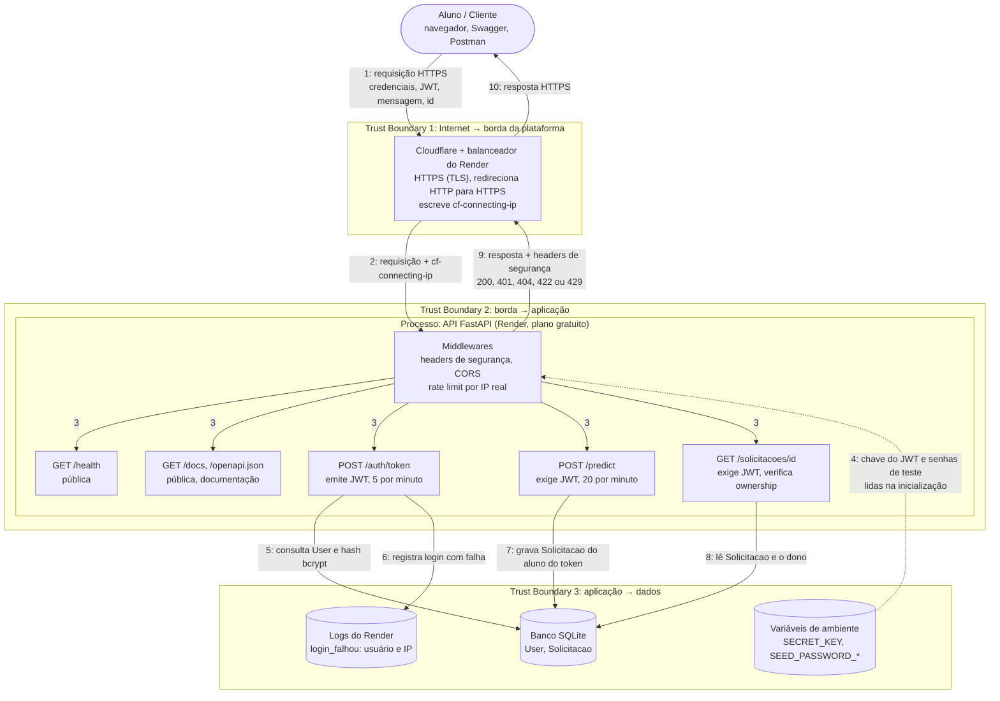
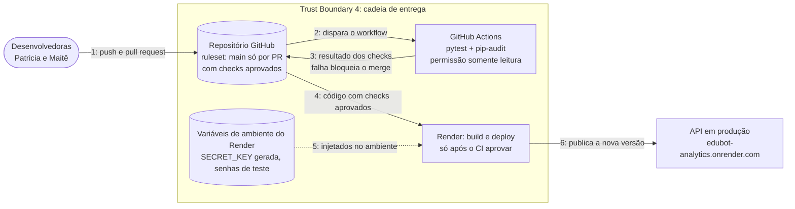

# DFD - EduBot Analytics

**Versão 3 (TP3).** O diagrama foi atualizado para refletir a API publicada no Render: a
borda da plataforma (Cloudflare + balanceador do Render), os segredos em variáveis de
ambiente, os logs de segurança, a documentação OpenAPI e a cadeia de entrega (GitHub,
GitHub Actions e deploy). O histórico das versões está no fim do documento.

O DFD foi dividido em dois diagramas, escritos em Mermaid neste arquivo. As imagens PNG
(`dfd-v3-requisicao.png` e `dfd-v3-cicd.png`) são geradas a partir deles com
`python dfd/gerar_imagens.py`. A imagem da versão anterior está em `historico/`.

- **Diagrama 1, fluxo de uma requisição:** o caminho dos dados quando um aluno usa a API.
- **Diagrama 2, cadeia de entrega:** o caminho do código até a API publicada.

## Elementos do diagrama

- **Entidades externas:**
  - **Aluno / Cliente:** usuário não confiável que acessa a API pela Internet (navegador, Swagger, Postman).
  - **Desenvolvedoras:** a dupla, que envia código ao repositório.
- **Processos:**
  - **Borda da plataforma (Cloudflare + balanceador do Render):** termina o HTTPS, redireciona HTTP para HTTPS e escreve o header `cf-connecting-ip` com o IP real do cliente.
  - **Middlewares da API:** headers de segurança, CORS e rate limit por IP real.
  - **Rotas da API:** `GET /health`, `GET /docs` (e `/openapi.json`), `POST /auth/token`, `POST /predict` e `GET /solicitacoes/{id}`.
  - **GitHub Actions:** roda os testes de segurança e o `pip-audit`.
  - **Render (build e deploy):** publica uma versão nova só depois que o CI aprova.
- **Armazenamentos de dados:**
  - **Banco SQLite** (via SQLModel), com as tabelas `User` (credenciais) e `Solicitacao`.
  - **Variáveis de ambiente do Render:** `SECRET_KEY` (gerada pelo Render) e senhas dos usuários de teste.
  - **Logs do Render:** tentativas de login que falharam (usuário, IP e headers de IP, nunca a senha).
  - **Repositório GitHub:** código-fonte, protegido pelo ruleset da `main`.

## Trust boundaries

1. **Internet → borda da plataforma:** tudo que vem do cliente é não confiável, inclusive
   headers como `X-Forwarded-For`, que o cliente pode escrever. A partir daqui o tráfego é
   HTTPS.
2. **Borda → aplicação:** a aplicação confia **somente** no header `cf-connecting-ip`, que
   a Cloudflare sobrescreve (tentar enviá-lo do cliente é bloqueado com 403). Corpo, token
   e parâmetros continuam não confiáveis até serem validados pela API.
3. **Aplicação → dados:** separa o código que atende requisições dos dados persistentes e
   dos segredos. Só a aplicação acessa o banco, as variáveis de ambiente e os logs.
4. **Cadeia de entrega (CI/CD):** separa quem escreve código do que vai para produção. O
   código só chega à `main` por pull request com os checks aprovados, e só é publicado
   depois do CI.

## Diagrama 1: fluxo de uma requisição

Código Mermaid do diagrama

## Diagrama 2: cadeia de entrega (CI/CD)

Código Mermaid do diagrama

## Entradas e saídas

**Entradas da API:**

- Credenciais (`username`, `password`) em `POST /auth/token`
- Token JWT no header `Authorization: Bearer <token>` em `POST /predict` e `GET /solicitacoes/{id}`
- Corpo da requisição (`mensagem`, até 2000 caracteres, sem campos extras) em `POST /predict`
- ID da solicitação (parâmetro de rota, inteiro maior ou igual a 1) em `GET /solicitacoes/{id}`
- Header `cf-connecting-ip`, escrito pela Cloudflare, usado pelo rate limit
- Variáveis de ambiente (`SECRET_KEY`, `SEED_PASSWORD_*`), lidas na inicialização

**Saídas da API:**

- Status de disponibilidade em `GET /health`
- Especificação OpenAPI em `/openapi.json` e página de documentação em `/docs`
- Token de acesso (JWT) em `POST /auth/token`, ou 401 (credenciais inválidas), 422 (formulário inválido) ou 429 (limite excedido, com `Retry-After`)
- Solicitação criada (id, categoria, urgência) em `POST /predict`, ou 401, 422 ou 429
- Dados da solicitação em `GET /solicitacoes/{id}`, se pertencer ao aluno autenticado, ou 404 (inexistente ou de outro aluno), 401 ou 422
- Headers de segurança (HSTS, X-Frame-Options, X-Content-Type-Options, CSP) em todas as respostas
- Registros de login com falha nos logs do Render

## Histórico de versões

| Versão | TP | O que mudou |
| --- | --- | --- |
| 1 | TP1 | Três rotas (`/health`, `/auth/token`, `/predict`) e credenciais em memória (`fake_db.py`). Duas trust boundaries |
| 2 | TP2 | Persistência em SQLite via SQLModel, rota `GET /solicitacoes/{id}` com ownership e rate limit no login |
| 3 | TP3 | API publicada no Render: borda Cloudflare/Render com HTTPS, segredos em variáveis de ambiente, logs de segurança, documentação OpenAPI, rate limit no `/predict`, cadeia de entrega (GitHub Actions + deploy condicionado ao CI). Quatro trust boundaries |
