# Projeto de Bloco: Análise e Segurança de Agentes de IA

## EduBot Analytics - TP3

**Alunas:** Maitê Mota Belo de Souza Silva e Patricia Dias Rodrigues

**Professor:** Ricardo Pires Mesquita

**Data:** {{data}}

**Repositório:** [https://github.com/patricia-diasr/edubot-analytics](https://github.com/patricia-diasr/edubot-analytics)

**API publicada:** [https://edubot-analytics.onrender.com](https://edubot-analytics.onrender.com) (documentação em [/docs](https://edubot-analytics.onrender.com/docs))

<!-- pagebreak -->

<!-- toc -->

<!-- pagebreak -->

# 1. Visão geral

O **EduBot Analytics** é um agente de IA de suporte acadêmico universitário. Ele atende alunos de graduação em pedidos de matrícula, trancamento de disciplinas e consulta de notas.

| Desafio | Descrição |
| --- | --- |
| Domínio | Atendimento acadêmico: matrícula, trancamento, consulta de notas |
| Desafio de IA | Classificar a urgência do pedido e a sua categoria (burocrático ou pedagógico) |
| Desafio de segurança | Evitar que alunos manipulem o agente para alterar notas ou acessar registros de outros estudantes |

O TP3 consolida a análise estatística e a API construída nos TPs anteriores. Na frente de Dados/IA, foi criada uma regressão linear múltipla, analisados os resíduos e formalizada a futura tarefa de classificação. Na frente de Infra/Sec, a API passou por uma auditoria final de segurança, ganhou uma suíte de testes integrada ao GitHub Actions, uma documentação OpenAPI completa e foi publicada em ambiente online, pronta para ser alvo do pentest do TP4.

## 1.1 Organização do repositório

| Pasta | Conteúdo |
| --- | --- |
| `api/` | API FastAPI: código (`app/`), 67 testes de segurança (`tests/`), dependências e modelo do `.env` |
| `eda/` | Notebooks de EDA, dataset, figuras e documentação dos dados |
| `dfd/` | DFD (versão 3), análise CIA, modelagem de ameaças STRIDE e histórico de versões do DFD |
| `security/` | Auditoria final, findings e relatórios do OWASP ZAP, decisões técnicas, deploy, plano de pentest e evidências |
| `.github/workflows/` | Workflow do GitHub Actions com os testes de segurança |
| `entregas/` | Relatórios de cada TP (Markdown, script e PDF) e prints de evidência |

As instruções de instalação, execução e testes estão no `README.md`, na raiz do repositório.

<!-- pagebreak -->

# 2. Regressão linear e transição para classificação

## 2.1 Regressão linear múltipla

O notebook `eda/eda_edubot_tp3.ipynb` usa regressão linear múltipla para prever `n_chars`, o número de caracteres de uma mensagem. As variáveis explicativas são `n_palavras`, as flags linguísticas do Bitext e `categoria_edubot`, transformada com one-hot encoding.

O pré-processamento e o `LinearRegression` ficam no mesmo pipeline do scikit-learn. Os dados foram separados em 80% para treino e 20% para teste, com `random_state=42`.

| Medida | Resultado |
| --- | ---: |
| Registros de treino | 16.804 |
| Registros de teste | 4.202 |
| R² no teste | 0,690 |
| RMSE | 6,243 caracteres |
| Média dos resíduos | 0,097 |

O modelo explica cerca de 69% da variação no número de caracteres. Isso acontece principalmente porque mensagens com mais palavras tendem a ter mais caracteres. O resultado não significa que o modelo entendeu o conteúdo.

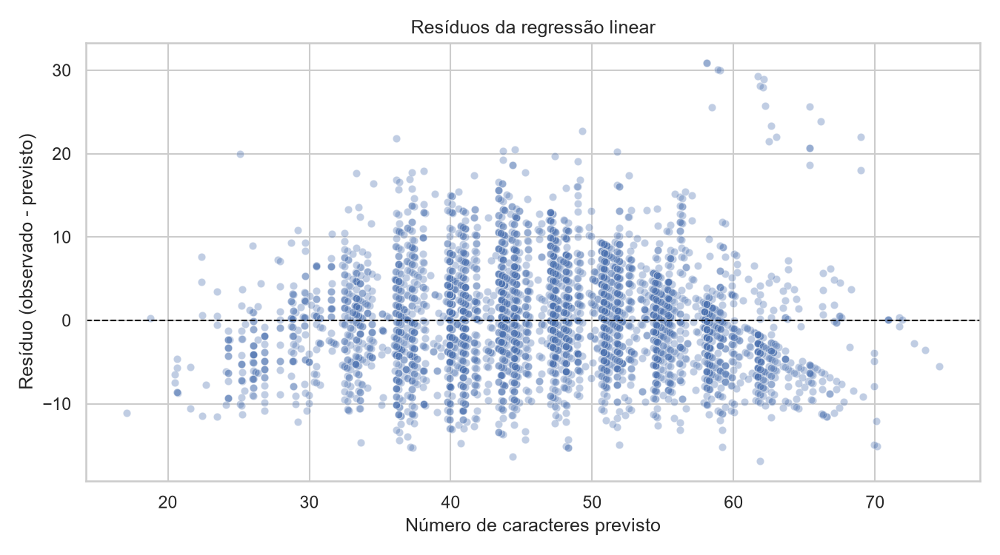

Os resíduos ficam em torno de zero, mas a dispersão não é perfeitamente uniforme. As faixas diagonais aparecem porque caracteres e palavras são contagens inteiras. A hipótese de variância constante não é plenamente atendida.

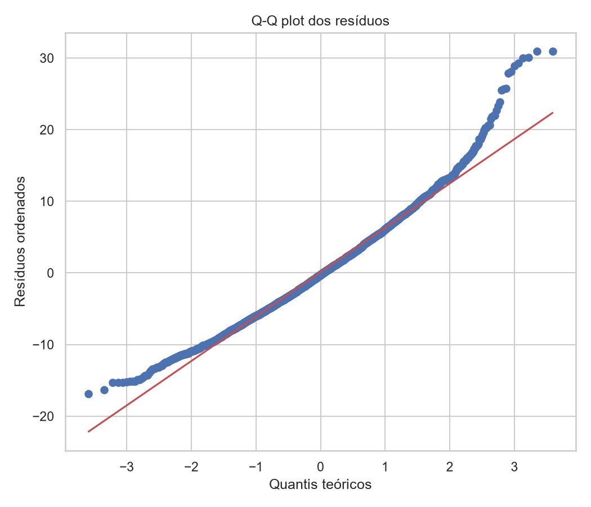

O centro do Q-Q plot fica razoavelmente perto da reta, mas as caudas se afastam. Os resíduos não são perfeitamente normais.

## 2.2 Limitações da regressão

- O alvo `n_chars` foi escolhido para praticar regressão e não representa a intenção da pessoa.
- A relação entre palavras e caracteres é parcialmente mecânica.
- Os resíduos apresentam desvios de homocedasticidade e normalidade.
- O Bitext é sintético, em inglês e voltado a e-commerce.
- Intenções são classes sem ordem numérica. A regressão linear pode devolver valores contínuos sem significado e não resolve a tarefa final.

## 2.3 Pergunta de classificação

A pergunta formalizada para o T2 é:

> Dado o texto de uma mensagem de atendimento, qual é a intenção do usuário?

A entrada será `instruction` e a saída será uma das 23 classes de `intent_edubot`. O dataset tratado tem 21.006 mensagens. A maior parte das classes tem entre 700 e 1.000 exemplos. `disciplina_trancar` é a menor, com 493.

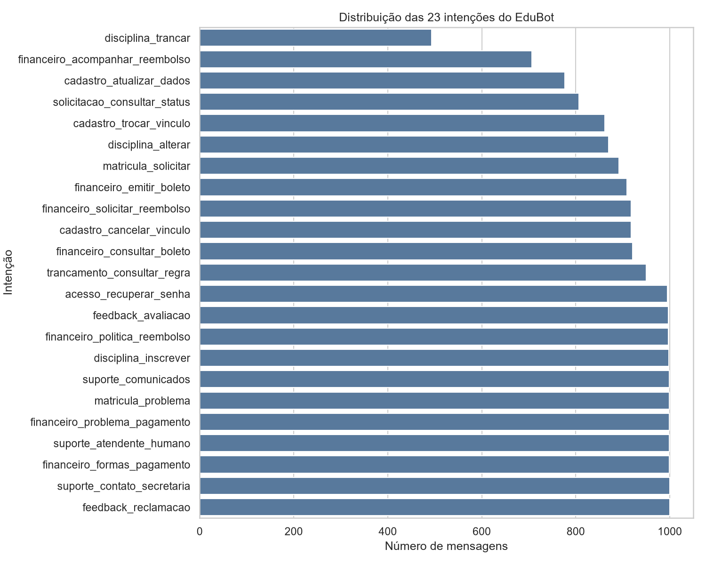

| Intenção | Mensagens | Percentual |
| --- | ---: | ---: |
| `acesso_recuperar_senha` | 995 | 4,74% |
| `cadastro_atualizar_dados` | 777 | 3,70% |
| `cadastro_cancelar_vinculo` | 918 | 4,37% |
| `cadastro_trocar_vinculo` | 862 | 4,10% |
| `disciplina_alterar` | 870 | 4,14% |
| `disciplina_inscrever` | 998 | 4,75% |
| `disciplina_trancar` | 493 | 2,35% |
| `feedback_avaliacao` | 997 | 4,75% |
| `feedback_reclamacao` | 1.000 | 4,76% |
| `financeiro_acompanhar_reembolso` | 707 | 3,37% |
| `financeiro_consultar_boleto` | 921 | 4,38% |
| `financeiro_emitir_boleto` | 909 | 4,33% |
| `financeiro_formas_pagamento` | 999 | 4,76% |
| `financeiro_politica_reembolso` | 997 | 4,75% |
| `financeiro_problema_pagamento` | 999 | 4,76% |
| `financeiro_solicitar_reembolso` | 918 | 4,37% |
| `matricula_problema` | 999 | 4,76% |
| `matricula_solicitar` | 892 | 4,25% |
| `solicitacao_consultar_status` | 807 | 3,84% |
| `suporte_atendente_humano` | 999 | 4,76% |
| `suporte_comunicados` | 999 | 4,76% |
| `suporte_contato_secretaria` | 1.000 | 4,76% |
| `trancamento_consultar_regra` | 950 | 4,52% |

As classes, descrições, quantidades, ambiguidades e limitações estão em `eda/pergunta_classificacao_tp3.md`.

## 2.4 Planejamento do T2

O baseline será TF-IDF com regressão logística. Depois, o mesmo conjunto de dados será usado para comparar `LinearSVC`. A avaliação terá Macro-F1 como métrica principal, além de precision, recall, acurácia e matriz de confusão.

O pipeline será treinado fora da API, salvo com uma versão e carregado uma vez na inicialização do FastAPI. O planejamento completo está em `eda/planejamento_t2.md`.

| Item do pentest | Situação |
| --- | --- |
| Colega ou equipe adversária | A definir pelo professor após a entrega |
| URL ou IP da API alvo | A definir pelo professor após a entrega |
| Confirmação de acesso | Será registrada depois do pareamento |

Na aula de 07/10/2026, o professor orientou que esses campos ficassem em aberto porque ele faria o pareamento depois das entregas. A mesma orientação foi confirmada nas aulas de 14/10/2026 e 21/10/2026.

# 3. Suíte de testes de segurança

A suíte de testes da API foi ampliada de 4 para **67 testes**, organizados por tema. Todos passam com `pytest tests/ -v`, localmente e no GitHub Actions.

| Arquivo | Testes | O que cobre |
| --- | --- | --- |
| `test_autenticacao.py` | 12 | Acesso sem token; token malformado, assinado com outra chave, com `alg: none`, expirado, sem `exp` e de usuário inexistente (todos 401); mesma resposta para senha errada e usuário inexistente; login e fluxo válidos |
| `test_bola.py` | 5 | Acesso à própria solicitação; bloqueio da solicitação de outro aluno; mesma resposta para "não existe" e "não é seu"; enumeração de IDs; dono definido pelo token, nunca pelo corpo |
| `test_validacao_entrada.py` | 16 | Campo extra, mensagem vazia, só espaços, acima de 2000 caracteres, tipos errados (422); erro 422 sem eco do valor enviado; SQL injection no ID, na mensagem e no login |
| `test_rate_limit.py` | 13 | 429 na 6ª tentativa de login e no 21º `/predict`; `Retry-After`; bloqueio mesmo com a senha certa; `X-Forwarded-For` forjado não burla o limite; IP real atrás de proxy; um atacante bloqueado não afeta outro aluno |
| `test_headers_cors.py` | 13 | Headers de segurança em todas as respostas, inclusive 401, 404 e 429; `Cache-Control: no-store`; CSP, SRI e versão fixa do `/docs`; CORS |
| `test_documentacao.py` | 8 | Todas as rotas documentadas no OpenAPI com todas as respostas possíveis e schemas; esquema de autenticação; `/redoc` removido |

```text
tests/test_autenticacao.py::test_predict_sem_token_retorna_401 PASSED
tests/test_bola.py::test_acesso_a_solicitacao_de_outro_usuario_retorna_404 PASSED
tests/test_validacao_entrada.py::test_campo_extra_no_body_e_rejeitado PASSED
tests/test_rate_limit.py::test_login_retorna_429_apos_exceder_o_limite PASSED
tests/test_headers_cors.py::test_docs_tem_csp_propria_sem_unsafe_inline PASSED
...
============================= 67 passed =============================
```

A saída completa está em `security/evidencias/pytest-tp3.txt`.

**Os testes realmente detectam falhas:** para confirmar que os testes não passam "sempre", a verificação de ownership foi removida de propósito. Os 3 testes de BOLA falharam imediatamente e voltaram a passar quando o código foi restaurado. A mesma demonstração foi feita no GitHub, com um pull request (seção 4).

# 4. Integração contínua com GitHub Actions

O workflow `.github/workflows/security-tests.yml` roda a cada push e em todo pull request para a `main`, com dois jobs:

1. **Testes de segurança (pytest):** instala as dependências e roda os 67 testes, com uma chave gerada só para aquela execução.
2. **Auditoria de dependências (pip-audit):** falha se alguma dependência tiver vulnerabilidade conhecida.

O workflow roda com permissão somente de leitura e não usa nenhum segredo real. Para que uma falha **impeça o merge**, a `main` é protegida por um ruleset: só recebe código por pull request, e com os dois checks aprovados. O Render, por sua vez, só publica uma nova versão depois que o CI aprova.

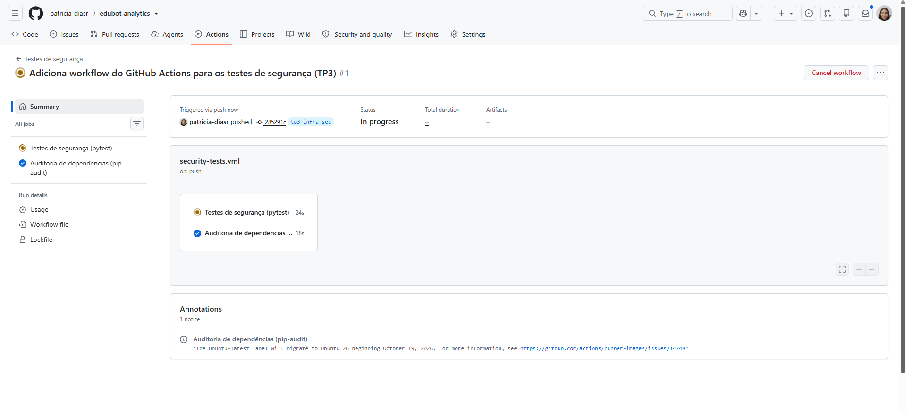

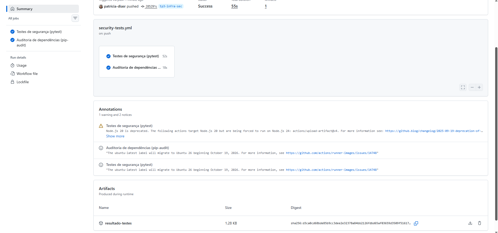

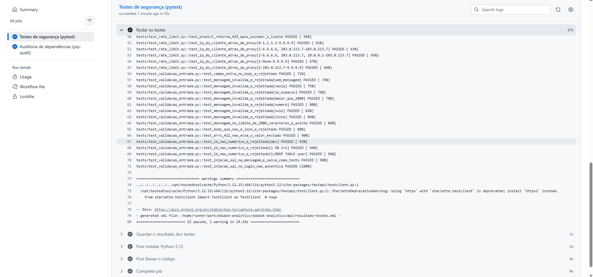

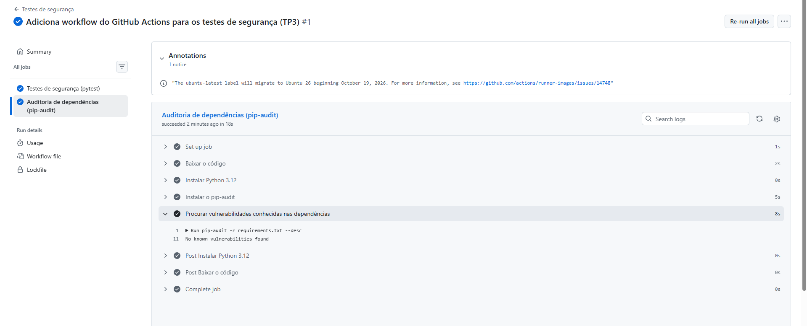

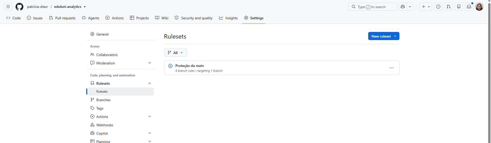

**Demonstração do bloqueio:** um pull request de teste removeu a verificação de ownership. Os testes de BOLA falharam no CI e o GitHub bloqueou o merge. O PR foi fechado sem merge.

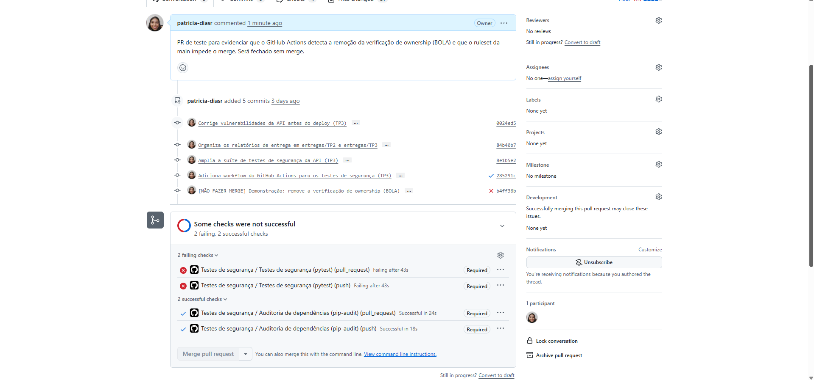

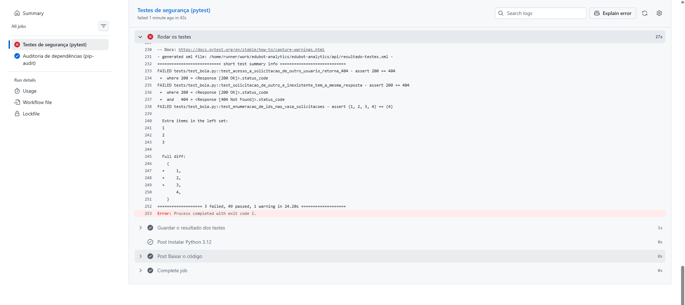

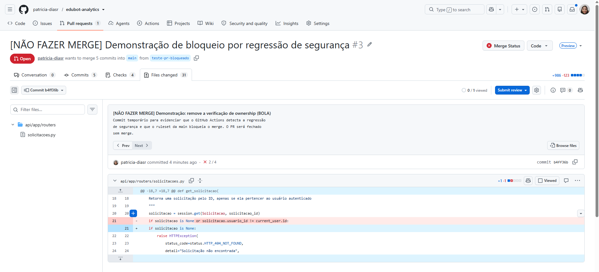

# 5. Auditoria final de segurança

A auditoria completa está em `security/auditoria-final-tp3.md`. A revisão do código do TP2, a auditoria de dependências e os testes contra a API publicada encontraram oito problemas, todos corrigidos:

| ID | Achado | CVSS 3.1 | Correção |
| --- | --- | --- | --- |
| A1 | Chave do JWT com valor padrão no código público, permitindo forjar tokens | 7.4 Alto | Chave obrigatória, forte, gerada no Render e fora do código |
| A2 | 35 vulnerabilidades conhecidas em 4 dependências | 7.5 Alto | Dependências atualizadas, `python-jose` trocado por `PyJWT` e `passlib` por `bcrypt` (35 para 0) |
| A3 | Rate limit ineficaz atrás do proxy do Render: todos os usuários dividiam o mesmo contador | 7.5 Alto | IP do cliente lido do `cf-connecting-ip`, escrito pela Cloudflare |
| A4 | Senhas dos usuários de teste no código público | 6.5 Médio | Senhas em variáveis de ambiente |
| A5 | `/predict` sem limite de requisições | 4.3 Médio | 20 requisições por minuto por IP |
| A6 | Enumeração de usuários pelo tempo de resposta do login | 3.7 Baixo | Tempo de resposta igual para usuário inexistente |
| A7 | Erro 422 repetindo o valor enviado | Informativo | Handler próprio sem eco |
| A8 | Mensagem só com espaços aceita | Informativo | Espaços removidos antes da validação |

**O achado A3 só apareceu em produção.** Os testes locais passavam, mas, contra a URL pública, 7 logins errados seguidos não geravam 429. Os logs mostraram que a API enxergava o IP interno do balanceador do Render, e não o do cliente. Depois da correção, o teste online mostrou 401 nas 5 primeiras tentativas e 429 na 6ª, mesmo com `X-Forwarded-For` falso. Tentar forjar o próprio `cf-connecting-ip` é barrado pela Cloudflare (403).

## 5.1 Checklist OWASP API Security Top 10

A auditoria traz o checklist do **OWASP API Security Top 10 (2023)**, com status e evidência de cada item, e os riscos aceitos com justificativa:

| Risco OWASP | Status |
| --- | --- |
| API1 Broken Object Level Authorization | Resolvido |
| API2 Broken Authentication | Resolvido |
| API3 Broken Object Property Level Authorization | Resolvido |
| API4 Unrestricted Resource Consumption | Resolvido |
| API5 Broken Function Level Authorization | Não aplicável (sem funções privilegiadas) |
| API6 Unrestricted Access to Sensitive Business Flows | Resolvido |
| API7 Server Side Request Forgery | Não aplicável |
| API8 Security Misconfiguration | Resolvido |
| API9 Improper Inventory Management | Resolvido |
| API10 Unsafe Consumption of APIs | Reavaliar no TP4 (agente com LLM) |

## 5.2 Scan final com OWASP ZAP

Um novo scan passivo foi feito contra a URL pública, com tráfego autenticado gerado pelo Swagger UI. Ele encontrou dois findings Médios na página `/docs`, que foram corrigidos: a página passou a ter CSP própria sem `'unsafe-inline'`, o Swagger UI passou a ter versão fixa e SRI, e o `/redoc` foi removido. O scan de verificação confirmou o resultado.

| Risco | Scan inicial | Scan de verificação |
| --- | --- | --- |
| Alto | 0 | 0 |
| Médio | 2 | **0** |
| Baixo | 1 | **0** |
| Informativo | 5 | 5 (aceitos, sem impacto) |

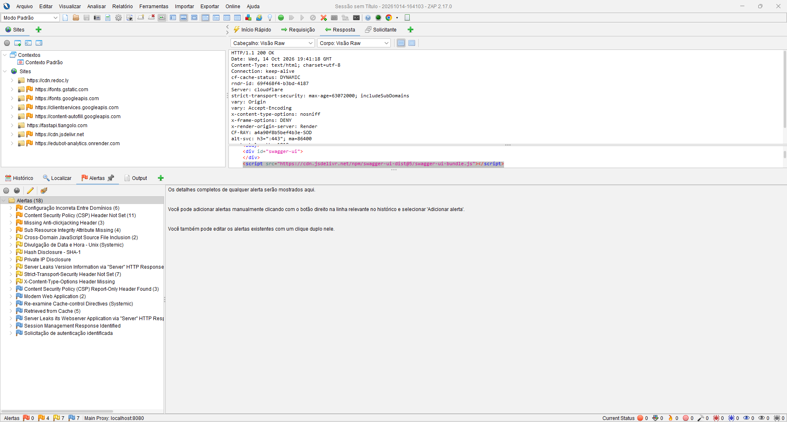

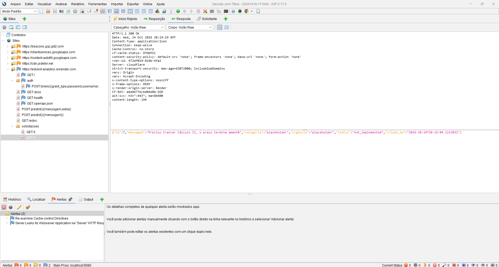

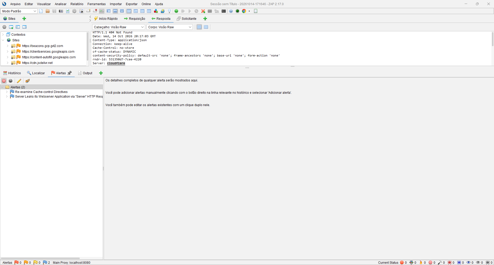

Os findings estão detalhados em `security/zap-findings-tp3.md`, e os relatórios em `security/zap-report-tp3-inicial.html` e `security/zap-report-tp3-verificacao.html`. **Não há nenhum finding Alto, Médio ou Baixo pendente.**

# 6. Documentação OpenAPI (/docs)

A especificação OpenAPI está em [/docs](https://edubot-analytics.onrender.com/docs) e documenta todas as rotas com resumo, descrição, schemas de entrada e saída, exemplos e **todas as respostas possíveis** (200, 401, 404, 422 e 429). A página abre com um guia de autenticação e uma tabela dos controles de segurança. Um teste automatizado garante que nenhuma rota fique sem documentação.

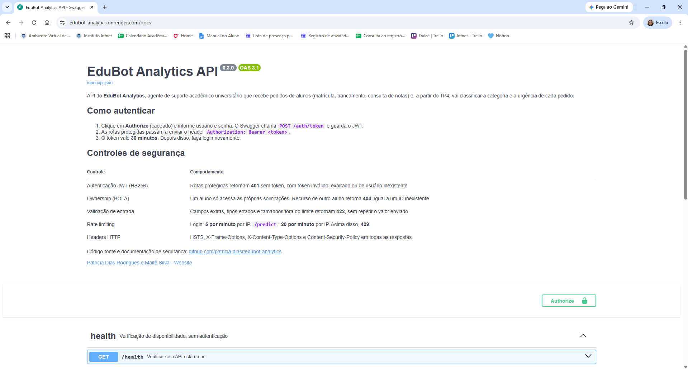

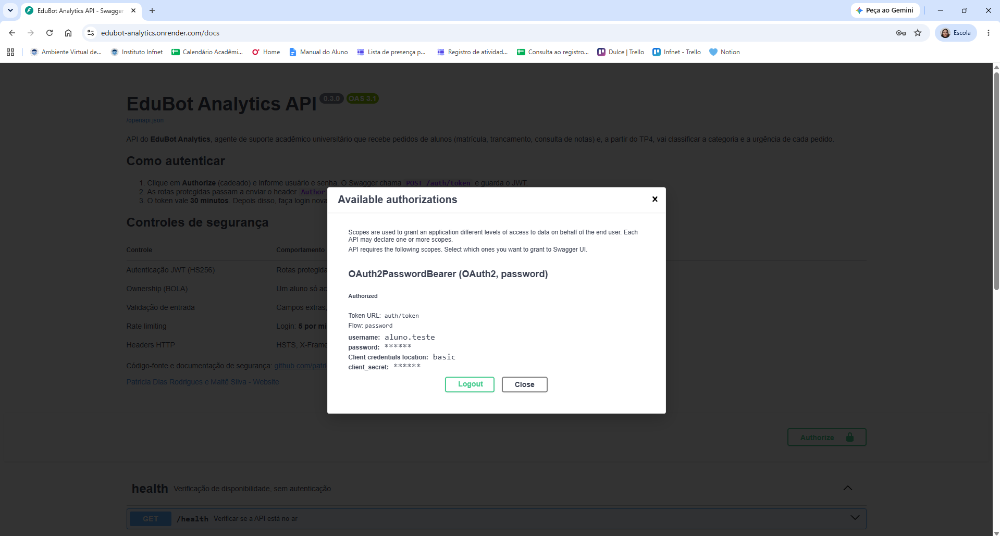

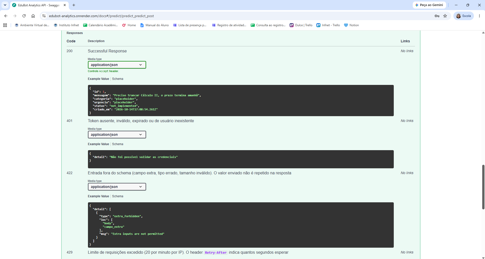

# 7. Deploy e prontidão para o pentest

A API está publicada no Render (plano gratuito), em [https://edubot-analytics.onrender.com](https://edubot-analytics.onrender.com). A configuração completa está em `security/deploy-render.md`:

- HTTPS terminado pela Cloudflare/Render, com redirecionamento de HTTP e HSTS efetivo (o risco aceito no TP2 foi resolvido);
- `SECRET_KEY` gerada pelo Render e senhas de teste apenas nas variáveis de ambiente;
- Python 3.12, a mesma versão do CI;
- deploy automático somente depois que o GitHub Actions aprova.

| Requisito para o pentest | Situação |
| --- | --- |
| API rodando sem erros em URL pública | Atendido (`/health` 200) |
| Autenticação funcionando | Atendido (print 10) |
| Dados de teste disponíveis | 3 alunos, cada um com solicitações próprias, recriados a cada inicialização |
| Documentação acessível | Atendido (prints 09 a 11) |
| Nenhum finding Médio ou Alto pendente | Atendido (seção 5.2) |

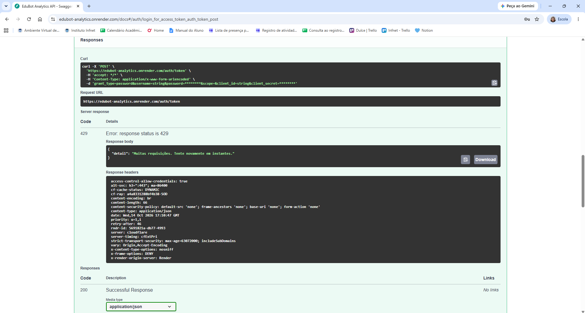

# 8. Planejamento do T2: pentest e segurança do agente

| Item | Situação |
| --- | --- |
| Colega adversário | A definir pelo professor após a entrega do TP3 |
| URL ou IP da API adversária | A definir pelo professor após a entrega do TP3 |
| Período do pentest | A definir pelo professor |
| Plano de escopo do pentest | Concluído (`security/plano-pentest.md`) |
| Plano de segurança do agente | Concluído (`security/plano-pentest.md`) |

## 8.1 Plano de escopo do pentest

**Pentest que a dupla vai realizar (TP4):** o plano define as regras de engajamento (somente a URL informada, dentro do período, com as contas de teste fornecidas; sem negação de serviço; sem ataques à plataforma de hospedagem), as etapas (reconhecimento, análise de configuração, testes de controles de acesso e de entrada, testes do agente e relatório), tendo como referência o OWASP WSTG e o OWASP API Security Top 10, e o formato de cada achado: categoria, evidência, impacto, severidade CVSS 3.1 e recomendação.

**Escopo para a dupla que vai testar o EduBot:** URL, documentação e repositório; no escopo, todas as rotas e, no TP4, o agente; fora do escopo, negação de serviço, a infraestrutura do Render e da Cloudflare, as contas da dupla e engenharia social. As senhas das contas de teste não ficam no repositório e serão enviadas por e-mail à dupla adversária. Contatos para credenciais e suporte: Patricia Dias Rodrigues (patricia.rodrigues@al.infnet.edu.br) e Maitê Mota Belo de Souza Silva (maite.silva@al.infnet.edu.br).

## 8.2 Plano de segurança do agente

No TP4, o `/predict` vai usar um agente com memória e ferramentas. Para responder ao desafio de segurança do EduBot, os controles planejados são:

- **Ferramentas somente de leitura:** o agente não terá nenhuma ferramenta capaz de alterar notas, matrículas ou cadastros.
- **Identidade definida pelo servidor:** o aluno é identificado pelo token JWT; as ferramentas recebem o ID do aluno da API, nunca do texto digitado na conversa.
- **Mesma regra de ownership da API** nas ferramentas de consulta.
- **Memória separada por aluno.**
- **Validação da saída:** categoria e urgência conferidas contra a lista de valores permitidos.
- **Chave do modelo de linguagem** apenas em variável de ambiente no Render.
- **Rate limit e limite de tamanho** do `/predict` mantidos, para controlar o custo.
- **Testes de segurança do agente** na mesma suíte do CI.

# 9. Atualização da modelagem de ameaças

Com a API publicada, o DFD, a análise CIA e a modelagem de ameaças dos TPs anteriores foram atualizados.

**DFD versão 3** (`dfd/dfd.md`), dividido em dois diagramas e com quatro trust boundaries: (1) Internet e borda da plataforma, (2) borda e aplicação, onde só o `cf-connecting-ip` é confiável, (3) aplicação e dados (banco, segredos e logs) e (4) cadeia de entrega.


| Versão do DFD | TP | Principais elementos |
| --- | --- | --- |
| 1 | TP1 | 3 rotas, credenciais em memória (`fake_db.py`), 2 trust boundaries |
| 2 | TP2 | SQLite, rota `GET /solicitacoes/{id}` com ownership, rate limit no login |
| 3 | TP3 | Borda Cloudflare/Render com HTTPS, segredos, logs, documentação, CI/CD; 4 trust boundaries |

**Análise CIA** (`dfd/analise-cia.md`), estendida de 5 para 10 componentes:

| Componente | Confidencialidade | Integridade | Disponibilidade |
| --- | --- | --- | --- |
| GET /health | Baixa | Baixa | Alta |
| POST /auth/token | Alta | Alta | Alta |
| POST /predict | Alta | Alta | Média |
| GET /solicitacoes/{id} | Alta | Alta | Média |
| Banco de dados (SQLite) | Altíssima | Alta | Baixa |
| Borda (Cloudflare + Render) | Alta | Alta | Média |
| Documentação (/docs, /openapi.json) | Baixa | Média | Baixa |
| Variáveis de ambiente (segredos) | Altíssima | Alta | Alta |
| Logs de segurança | Média | Média | Baixa |
| Cadeia de entrega (CI/CD) | Média | Altíssima | Média |

A disponibilidade do banco caiu de média para baixa no TP3, porque o disco do plano gratuito do Render é apagado a cada deploy. É um risco aceito: os dados de teste são recriados automaticamente.

**Modelagem de ameaças STRIDE** (`dfd/threat-model-stride.md`), criada no TP3 para completar a modelagem de ameaças iniciada no TP1: 32 ameaças, cada uma ligada a um elemento do DFD, com o controle, o status e o teste que a comprova. Inclui as ameaças do agente de IA, como prompt injection para alterar notas ou acessar dados de outros alunos.

| Categoria | Mitigadas | Aceitas | Planejadas (agente) |
| --- | --- | --- | --- |
| Spoofing | 4 | 1 | 0 |
| Tampering | 6 | 0 | 1 |
| Repudiation | 1 | 1 | 0 |
| Information disclosure | 6 | 1 | 2 |
| Denial of service | 4 | 1 | 1 |
| Elevation of privilege | 1 | 0 | 2 |
| **Total** | **22** | **4** | **6** |

# 10. Uso de IA

Conforme a política de Sinal Verde da disciplina:

- Na frente de Dados/IA, foram usados o Claude e o Cursor para triagem de datasets, estrutura dos notebooks, scripts e revisão de texto. A escolha do dataset, o mapeamento, a limpeza, as hipóteses e as interpretações são decisões da aluna responsável.
- Na frente de Infra/Sec, o Claude foi usado como apoio na implementação e revisão da API, na auditoria de segurança e na revisão da documentação. As decisões de implementação, a revisão do código e a validação das soluções foram feitas pela aluna responsável.
- Os números, testes e relatórios citados vêm da execução das ferramentas indicadas e podem ser reproduzidos a partir do repositório.

# 11. Índice de evidências

| Evidência | Local |
| --- | --- |
| Notebook de regressão e figuras | `eda/eda_edubot_tp3.ipynb`, `eda/figures/fig10` a `fig12` |
| Pergunta de classificação | `eda/pergunta_classificacao_tp3.md` |
| Planejamento técnico do T2 | `eda/planejamento_t2.md` |
| Código da API | `api/app/` |
| Testes de segurança e saída do pytest | `api/tests/`, `security/evidencias/pytest-tp3.txt` |
| Auditoria de dependências (antes e depois) | `security/evidencias/pip-audit-antes-tp2.txt`, `pip-audit-depois-tp3.txt` |
| Workflow de CI | `.github/workflows/security-tests.yml` |
| DFD, CIA e STRIDE | `dfd/dfd.md`, `dfd/analise-cia.md`, `dfd/threat-model-stride.md` |
| Relatórios e findings do ZAP | `security/zap-report-tp3-*.html`, `security/zap-findings-tp3.md` |
| Auditoria final e checklist OWASP | `security/auditoria-final-tp3.md` |
| Decisões técnicas | `security/decisoes-tecnicas.md` |
| Deploy | `security/deploy-render.md` |
| Plano de pentest e segurança do agente | `security/plano-pentest.md` |
| Prints | `entregas/TP3/prints/` |
