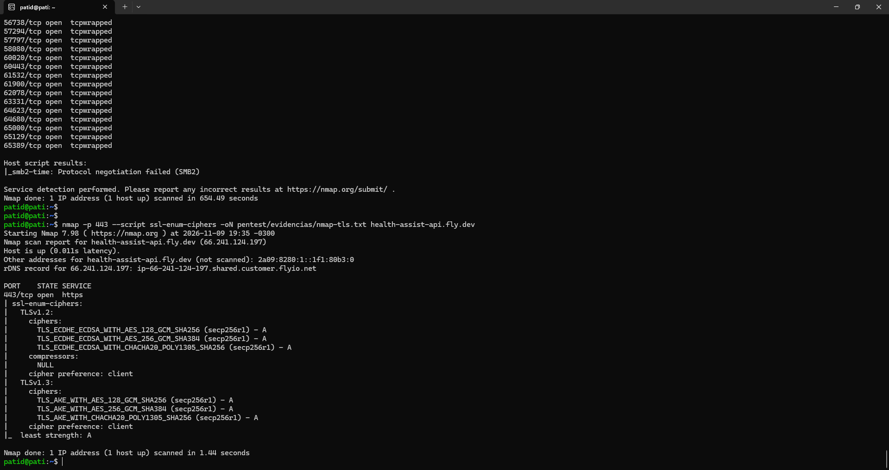
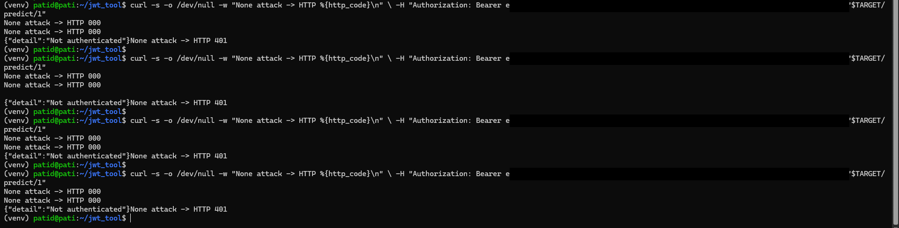
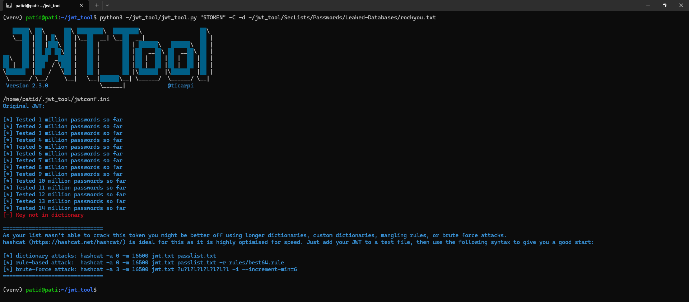
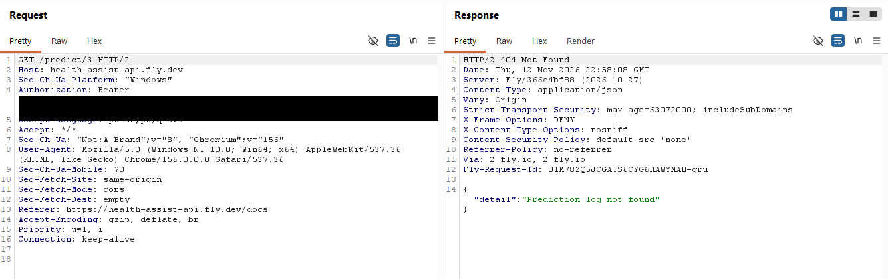
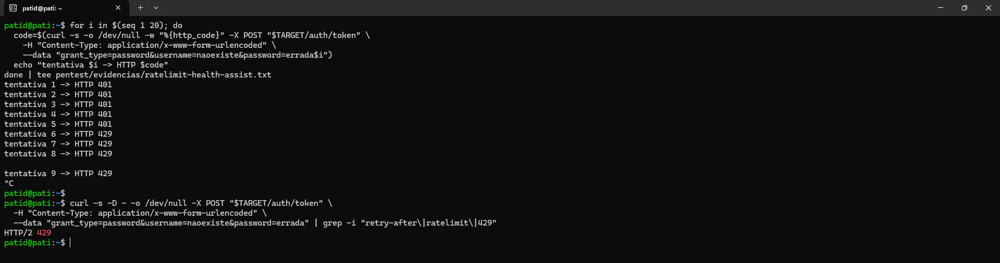

# Projeto de Bloco: Análise e Segurança de Agentes de IA

## EduBot Analytics - TP4

**Alunas:** Maitê Mota Belo de Souza Silva e Patricia Dias Rodrigues

**Professor:** Ricardo Pires Mesquita

**Data:** {{data}}

**Repositório:** [https://github.com/patricia-diasr/edubot-analytics](https://github.com/patricia-diasr/edubot-analytics)

**API publicada (EduBot):** [https://edubot-analytics.onrender.com](https://edubot-analytics.onrender.com) (documentação em [/docs](https://edubot-analytics.onrender.com/docs))

**API alvo do pentest (HealthAssist):** [https://health-assist-api.fly.dev](https://health-assist-api.fly.dev)

<!-- pagebreak -->

<!-- toc -->

<!-- pagebreak -->

# 1. Visão geral

O EduBot Analytics é um agente de IA de suporte acadêmico universitário (matrícula, trancamento de disciplinas e consulta de notas). O TP4 avança em duas frentes paralelas: a construtiva (classificador de intenções e agente) e a ofensiva (pentest na API da dupla adversária).

Este relatório documenta a frente de Infraestrutura e Segurança: o pentest adversarial na API da dupla alvo.

| Desafio | Descrição |
| --- | --- |
| Domínio | Atendimento acadêmico: matrícula, trancamento, consulta de notas |
| Desafio de segurança (nossa API) | Evitar que alunos manipulem o agente para alterar notas ou acessar registros de outros estudantes |
| Alvo do pentest | HealthAssist API — triagem médica e agendamentos (dados de saúde, LGPD) |

> **Status desta versão:** a fase parcial de pentest do TP4 está concluída — reconhecimento (seção 3), ataques JWT (seção 4) e autorização/fuzzing/rate limiting (seção 5) foram todos executados e documentados. Em nenhum vetor testado foi confirmada vulnerabilidade explorável; a API alvo apresentou postura de segurança forte. O único vetor em aberto é a injeção de SQL, reservada ao TP5 (SQLmap).

<!-- pagebreak -->

# 2. Pentest adversarial: metodologia e escopo

O pentest segue o OWASP Web Security Testing Guide (WSTG) e o OWASP API Security Top 10 (2023), nas etapas: reconhecimento → análise de configuração → testes de controle de acesso e entrada → relatório. A severidade dos achados usa CVSS 3.1, a mesma escala da auditoria do TP3, para que os relatórios emitido e recebido sejam comparáveis.

**Alvo e autorização.** A API alvo é a HealthAssist API (`https://health-assist-api.fly.dev`; IP `66.241.124.197`), da dupla Vinícius Evangelista Paulo de Souza e Samuel Leutner Ferreira. O acesso foi autorizado por escrito pela dupla, que forneceu a URL, a documentação (`/docs`, `/redoc`) e contas de teste para a rota `/auth/token`. Os testes se limitam a essa URL e às contas fornecidas. O registro completo do escopo está em `security/plano-pentest.md`.

**Regras de engajamento:** testar somente a URL autorizada e com as contas de teste fornecidas; não executar negação de serviço, carga ou qualquer ação que deixe a API indisponível; não atacar a infraestrutura de hospedagem (Fly.io); não apagar nem alterar dados além do mínimo para comprovar um achado; não coletar nem expor dados reais de paciente (a API alvo trata dados de saúde, sujeitos à LGPD); e interromper os testes a pedido da dupla ou do professor.

O log técnico completo, com todos os comandos e saídas, está em `pentest/01-recon.md` e `pentest/02-ataques.md`.

> **Nota sobre as evidências:** nos prints deste relatório, as credenciais de teste e os tokens JWT foram tarjados (barras pretas) por segurança. Os códigos de status e as respostas que comprovam cada teste permanecem legíveis.

# 3. Reconhecimento (executado)

## 3.1 Superfície de ataque (OpenAPI)

A especificação pública (`GET /openapi.json`, 200 OK, salva em `pentest/evidencias/openapi-health-assist.json`) revela uma superfície enxuta:

| Método | Rota | Autenticação | Entrada | Observação |
| --- | --- | --- | --- | --- |
| GET | `/health` | Pública | — | Health check |
| POST | `/auth/token` | Pública | `username`, `password` (OAuth2 password) | Emite o JWT |
| POST | `/predict/` | JWT | `symptoms_description`, `patient_age` | Triagem de sintomas |
| GET | `/predict/{log_id}` | JWT | `log_id` (inteiro, no path) | Lê um log de predição; retorna `input_data` (sintomas) |

Tecnologias: aplicação FastAPI (OpenAPI 3.1.0, `OAuth2PasswordBearer`, erros no formato `{"detail": ...}` e `ValidationError`/422), publicada atrás do proxy da Fly.io (`server: Fly/...`). A própria descrição da API declara conter "proteções contra BOLA, Rate Limiting e cabeçalhos de segurança padrão OWASP".

## 3.2 Cabeçalhos de segurança

Presentes em todas as respostas, compondo um baseline forte: `strict-transport-security` (HSTS), `x-frame-options: DENY`, `x-content-type-options: nosniff`, `content-security-policy: default-src 'none'` e `referrer-policy: no-referrer`.

## 3.3 CORS

Com um cabeçalho `Origin` arbitrário, o servidor responde `access-control-allow-credentials: true` e `vary: Origin`, mas não devolve `Access-Control-Allow-Origin`. Como não há reflexão da origem, o navegador bloqueia a leitura cross-origin. Avaliação: informativo — não explorável na configuração atual (há uma whitelist de origens no middleware).

## 3.4 Autenticação

- A autenticação é exigida corretamente: `GET /predict/1` e `POST /predict/` sem token retornam `401 {"detail":"Not authenticated"}`.
- Um login com credenciais inválidas retorna uma mensagem genérica (`{"detail":"Incorrect username or password"}`), sem distinguir usuário inexistente de senha errada → sem enumeração de usuários pela mensagem (controle positivo).

## 3.5 Reconhecimento ativo (Nmap, Gobuster, Kiterunner)

Executado em 10/11/2026 (saídas em `pentest/evidencias/`, prints em `entregas/TP4/prints/`):

- Nmap (`-sV -sC -Pn`): as 1000 portas do top-ports aparecem como `open/tcpwrapped` — comportamento do proxy anycast da Fly.io (completa o handshake TCP em qualquer porta, sem serviço real). O único serviço efetivo é a 443/tcp (https). rDNS: `ip-66-241-124-197.shared.customer.flyio.net`.
- Nmap TLS (`ssl-enum-ciphers`): apenas TLS 1.2 e 1.3, todas as cifras nota A. Sem protocolos ou cifras fracas.
- Gobuster (`common.txt`): apenas `/docs` e `/health` (200).
- Kiterunner (`routes-small.kite`): apenas `/docs` (GET 200; PUT 405).

Conclusão: superfície de rede mínima (só a 443, via Fly.io), TLS forte e nenhum endpoint além dos quatro já conhecidos pelo OpenAPI. Isso enfraquece a hipótese de endpoints administrativos ocultos (H4). Detalhes em `pentest/01-recon.md` (seção 7).

<!-- pagebreak -->

# 4. Ataques JWT (jwt_tool)

Executados com jwt_tool 2.3.0 sobre um token legítimo emitido por `/auth/token` (`alg: HS256`). Log completo em `pentest/02-ataques.md`; prints `08`–`11`.

| Ataque | Método | Resultado |
| --- | --- | --- |
| None Attack (`alg:none`) | `jwt_tool -X a` gera 4 variações sem assinatura; cada token enviado a `/predict/1` | ❌ **Rejeitado** — `401 Not authenticated` nas 4 variações. A assinatura é validada e `alg:none` não é aceito |
| Algorithm Confusion (RS256→HS256) | — | **Não aplicável** — o token usa HS256 (simétrico); o ataque só vale para tokens RSxx |
| Crack do segredo HS256 | `jwt_tool -C -d rockyou.txt` | ❌ **Não quebrado** — `Key not in dictionary` após ~14 milhões de senhas. Segredo resistente a dicionário |

Avaliação: nenhuma vulnerabilidade de JWT. A hipótese H2 é **refutada** — assinatura validada, `alg:none` bloqueado e segredo forte.

# 5. Autorização quebrada (BOLA/BFLA/IDOR), fuzzing e rate limiting

Executado com duas contas de teste (A e B). Log completo em `pentest/02-ataques.md`; prints `12`–`22`.

BOLA / IDOR — **sem vulnerabilidade.** Por enumeração (inclusive via Burp Intruder) confirmou-se que A possui os `log_id` 1 e 2 e B possui o `log_id` 3. O teste de acesso cruzado (Burp Repeater) nos dois sentidos:

| Requisição | Resultado |
| --- | --- |
| A lê o próprio `log_id` 2 | `200` (`input_data: "teste conta A"`) |
| A lê o `log_id` 3, de B | **`404` — Prediction log not found** |
| B lê o `log_id` 2, de A | **`404` — Prediction log not found** |
| B lê o próprio `log_id` 3 | `200` (`input_data: "teste conta B"`) |

O acesso cruzado é negado nos dois sentidos: cada conta só lê os próprios registros, e os dos outros retornam `404` (sem sequer revelar que existem). H1 **refutada** — autorização por objeto correta. (Os `input_data` eram dados de teste criados por nós, sem PII real.)

Ponto positivo adicional — sem oráculo de existência. Um log de outro usuário (ex.: `log_id` 3 para A) e um log inexistente (`log_id` 4–10) retornam a *mesma* resposta (`404`, mesmo corpo) e com tempos de resposta indistinguíveis (coluna *Response received* do Burp Intruder: ~282 ms vs. ~261–283 ms, dentro do ruído de rede). A API não expõe um oráculo de existência — por status, conteúdo ou tempo —, impedindo a enumeração de `log_id` válidos. É uma observação empírica (não uma medição formal de *constant-time*), mas um indicador defensivo positivo.

BFLA — **sem vulnerabilidade.** Métodos indevidos em `/predict/{id}` (`DELETE`/`PUT`/`PATCH`) → `405`; rotas administrativas/listagem (`/users`, `/admin`, `/logs`, `GET /predict/`) → `404`/`405`. Nenhum endpoint vaza registros de terceiros. H4 refutada.

Fuzzing (Wfuzz) — **sem endpoints ocultos.** 295 requisições autenticadas; só `/docs` e `/openapi.json` (já conhecidos) responderam.

Rate limiting — **efetivo.** Sonda limitada a 20 tentativas de login com senha errada (sem DoS): `401` até a 5ª e `429 Too Many Requests` a partir da 6ª. H3 refutada.

# 6. Avaliação e hipóteses

Situação das hipóteses após a fase parcial concluída:

| # | Hipótese | Onde | Status | Resultado |
| --- | --- | --- | --- | --- |
| H1 | BOLA / IDOR com `log_id` (dado de saúde, LGPD) | `GET /predict/{log_id}` | Testada (2 contas) | **Sem vulnerabilidade** — acesso cruzado negado (`404`) |
| H2 | Fraqueza de JWT (`alg:none`, confusão, segredo fraco) | `/auth/token` | Testada | **Sem vulnerabilidade** |
| H3 | Rate limiting ineficaz | `/auth/token` | Testada | **Sem vulnerabilidade** — `429` a partir da 6ª |
| H4 | BFLA / endpoints ocultos | descoberta | Testada | **Sem vulnerabilidade** — `405`/`404` |
| H5 | SQL injection no parâmetro `log_id` | `GET /predict/{log_id}` | TP5 | Alvo do SQLmap no TP5 |

Nenhum achado explorável foi confirmado nos vetores desta fase. O endpoint `GET /predict/{log_id}` permanece como o de maior risco residual a investigar (H5) e será o foco do SQLmap no TP5.

# 7. Próximos passos

- Executar a injeção de SQL com SQLmap em `GET /predict/{log_id}` (TP5).
- Consolidar os achados com severidade CVSS 3.1 e emitir o relatório à dupla alvo.
- Receber e tratar o relatório de pentest que a dupla adversária fará contra a EduBot.
- Garantir a segurança do endpoint `POST /classify` (JWT, validação, rate limiting) e mantê-lo coberto pelo CI, na integração do classificador e do agente.

# 8. Uso de IA

Ferramentas de IA foram usadas como apoio na organização do reconhecimento, na redação deste relatório e na automação das requisições HTTP de recon. Toda a análise de segurança, a definição do escopo, a validação dos achados e as decisões técnicas foram revisadas pela responsável de Infra/Sec.

# 9. Índice de evidências

| Evidência | Arquivo |
| --- | --- |
| Log do reconhecimento (método, comandos, achados, recon ativo) | `pentest/01-recon.md` |
| Log dos ataques (JWT, BOLA/BFLA, fuzzing, rate limiting) | `pentest/02-ataques.md` |
| Especificação OpenAPI da API alvo | `pentest/evidencias/openapi-health-assist.json` |
| Saída do Nmap (portas) e TLS | `pentest/evidencias/nmap-health-assist.txt` · `nmap-tls.txt` |
| Saída do Gobuster | `pentest/evidencias/gobuster-health-assist.txt` |
| Saída do Kiterunner (transcrita do print) | `pentest/evidencias/kiterunner-health-assist.txt` |
| BFLA (métodos/rotas, transcrita) · BOLA (enumeração + acesso cruzado) | `pentest/evidencias/bfla-metodos-health-assist.txt` · `bola-enum-health-assist.txt` · `bola-health-assist.txt` |
| Fuzzing (Wfuzz) · Rate limiting | `pentest/evidencias/wfuzz-health-assist.txt` · `ratelimit-health-assist.txt` |
| Alvo e escopo autorizado | `security/plano-pentest.md` (seção 1) |
| Prints: recon (`01`–`07`), JWT (`08`–`11`), BFLA/fuzzing/rate limiting (`12`–`14`), BOLA (`15`–`22`) | `entregas/TP4/prints/` |
