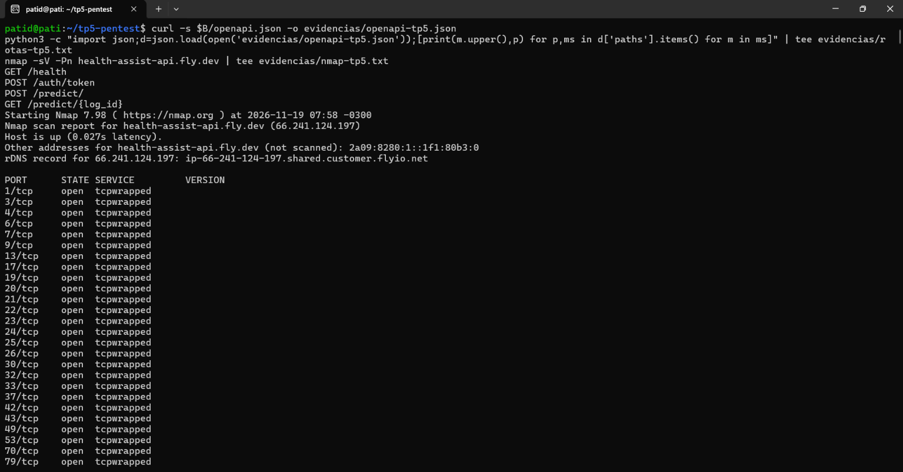

# Relatório final de pentest — HealthAssist API

## EduBot Analytics (dupla atacante) → HealthAssist API (dupla alvo)

**Autora (Infra/Sec):** Patricia Dias Rodrigues

**Dupla alvo:** Vinícius Evangelista Paulo de Souza e Samuel Leutner Ferreira

**Professor:** Ricardo Pires Mesquita

**Data:** {{data}}

**Alvo:** [https://health-assist-api.fly.dev](https://health-assist-api.fly.dev) (IP `66.241.124.197`)

**Repositório (atacante):** [https://github.com/patricia-diasr/edubot-analytics](https://github.com/patricia-diasr/edubot-analytics)

<!-- pagebreak -->

<!-- toc -->

<!-- pagebreak -->

# 1. Sumário executivo

Este relatório consolida o pentest adversarial autorizado contra a **HealthAssist API** (triagem
médica; dados de saúde, sujeitos à LGPD), realizado em duas fases: TP4 (reconhecimento, JWT,
autorização, fuzzing, rate limiting) e TP5 (injeção de SQL com SQLmap e ataques avançados). O
objetivo foi avaliar a segurança da API sob a ótica do OWASP API Security Top 10 (2023), com
severidade em CVSS 3.1.

**Resultado geral: nenhuma vulnerabilidade explorável foi confirmada.** A HealthAssist apresenta uma
postura de segurança forte e consistente em todos os vetores testados: autenticação JWT robusta
(assinatura validada, `alg:none` bloqueado, segredo resistente a dicionário), autorização por
objeto correta (sem BOLA/IDOR), validação de entrada estrita (Pydantic com whitelist de campos e
tipos), consultas ao banco parametrizadas (sem SQLi/NoSQLi), rate limiting efetivo e não contornável
por `X-Forwarded-For`, cabeçalhos de segurança completos e TLS 1.2/1.3 nota A.

Foram registrados apenas **dois pontos de atenção de baixa severidade / informativos**, nenhum
explorável na configuração atual:

| ID | Achado | Severidade | CVSS 3.1 |
| --- | --- | --- | --- |
| F1 | Reflexão de entrada não sanitizada em `input_data` (XSS armazenado latente) | Baixo | 3.5 |
| F2 | `access-control-allow-credentials: true` sem reflexão de origem | Informativo | 0.0 |

A cobertura abrangeu **8 das 10 categorias** do OWASP API Security Top 10 (2023) — ver seção 6.

<!-- pagebreak -->

# 2. Metodologia e escopo

O pentest seguiu o OWASP Web Security Testing Guide (WSTG) e o OWASP API Security Top 10 (2023), nas
etapas: reconhecimento → análise de configuração → testes de injeção e de lógica de negócio →
relatório. A severidade usa CVSS 3.1, a mesma escala da auditoria interna do TP3, para que os
relatórios emitido e recebido sejam comparáveis.

**Alvo e autorização.** A dupla alvo autorizou por escrito o teste e forneceu a URL, a documentação
(`/docs`, `/redoc`), a Collection do Postman e contas de teste para `/auth/token`. Os testes se
limitaram a essa URL e às contas fornecidas. O escopo completo está em
[`../security/plano-pentest.md`](../security/plano-pentest.md).

**Regras de engajamento:** testar somente a URL autorizada e com as contas de teste; não executar
negação de serviço, carga ou qualquer ação que deixe a API indisponível; não atacar a infraestrutura
de hospedagem (Fly.io); não apagar nem alterar dados além do mínimo para comprovar um achado; não
coletar nem expor dados reais de paciente; interromper a pedido da dupla ou do professor.

**Infraestrutura de teste (SQLmap).** Como o JWT expira em ~20 min e uma varredura completa do
SQLmap (com `--delay` para respeitar o rate limit) dura mais que isso, usei um **proxy reverso
local** que renova o token automaticamente e o injeta nas requisições (`auth-proxy.py`,
`127.0.0.1:8000`). O SQLmap aponta para o proxy, o token nunca vence no meio do scan e o rate limit
segue respeitado.

> **Nota sobre as evidências:** nos prints deste relatório, as credenciais de teste e os tokens JWT
> foram tarjados (barras pretas) por segurança. Os códigos de status e as respostas que comprovam
> cada teste permanecem legíveis. Os logs técnicos completos estão em
> [`01-recon.md`](01-recon.md), [`02-ataques.md`](02-ataques.md) e
> [`03-sqli-ataques-avancados.md`](03-sqli-ataques-avancados.md).

# 3. Superfície de ataque

A especificação OpenAPI pública (`GET /openapi.json`, 200 OK) revela uma superfície enxuta — quatro
rotas:

| Método | Rota | Autenticação | Entrada |
| --- | --- | --- | --- |
| GET | `/health` | Pública | — |
| POST | `/auth/token` | Pública | `username`, `password` (OAuth2 password) |
| POST | `/predict/` | JWT | `symptoms_description`, `patient_age` |
| GET | `/predict/{log_id}` | JWT | `log_id` (inteiro, no path) |

Tecnologias: FastAPI (OpenAPI 3.1.0, `OAuth2PasswordBearer`, erros `{"detail": ...}` e
`ValidationError`/422), atrás do proxy da Fly.io. Nmap: todas as portas do top-ports como
`tcpwrapped` (comportamento do proxy anycast), só a 443 efetiva; TLS 1.2/1.3 com cifras nota A.



<!-- pagebreak -->

# 4. Achados

## F1 — Reflexão de entrada não sanitizada em `input_data` (XSS armazenado latente)

**Severidade:** Baixo — **CVSS 3.1 Base 3.5** (`AV:N/AC:L/PR:L/UI:R/S:U/C:N/I:L/A:N`).
**Categoria:** OWASP API8:2023 (Security Misconfiguration) / Injection.

**Descrição.** O `symptoms_description` enviado em `POST /predict/` é armazenado e devolvido
*verbatim* no campo `input_data` de `GET /predict/{log_id}`, sem sanitização. Um payload de script é
persistido como enviado.

**Prova de conceito.**

```bash
# cria um log com payload de XSS (200 success)
curl -s -X POST $B/predict/ -H "Authorization: Bearer <TOKEN>" -H "Content-Type: application/json" \
  --data '{"symptoms_description":"<script>alert(1)</script>","patient_age":30}'
# relê o log: o payload volta íntegro em input_data
curl -s $B/predict/1255 -H "Authorization: Bearer <TOKEN>"
# -> {"id":1255,"input_data":"<script>alert(1)</script>","prediction_result":"Urgência Moderada"}
```

**Por que NÃO é explorável hoje (fatores atenuantes fortes).**

- A resposta é `content-type: application/json`, não `text/html` — o navegador não interpreta o
  conteúdo como marcação.
- O cabeçalho `content-security-policy: default-src 'none'` bloqueia a execução de qualquer script.
- A autorização por objeto está correta (ver seção 5): cada conta só lê os próprios `log_id`, então
  um atacante só injetaria contra si mesmo.

**Risco residual (por que não é zero).** Se, no futuro, algum consumidor renderizar `input_data` como
HTML (ex.: um painel administrativo que liste logs de todos os pacientes), a entrada não sanitizada
vira um XSS armazenado real. É uma questão de defesa em profundidade.

**Recomendação.** Sanitizar/escapar `input_data` na escrita ou na leitura (ex.: *HTML-encode*), e
manter o `content-type: application/json` e a CSP em qualquer cliente que venha a exibir esse campo.


## F2 — `access-control-allow-credentials: true` sem reflexão de origem

**Severidade:** Informativo — **CVSS 3.1 0.0** (sem impacto demonstrável).
**Categoria:** OWASP API8:2023 (Security Misconfiguration).

**Descrição.** Com um `Origin` arbitrário, o servidor responde `access-control-allow-credentials:
true` e `vary: Origin`, mas **não** devolve `Access-Control-Allow-Origin`. Como a origem não é
refletida, o navegador bloqueia a leitura cross-origin — não há exposição. Anunciar
`allow-credentials: true` sem refletir a origem é inócuo, mas é ruído de configuração.

**Recomendação.** Omitir `access-control-allow-credentials` quando a origem não estiver na whitelist,
para evitar ambiguidade na configuração do CORS.

<!-- pagebreak -->

# 5. Vetores testados sem vulnerabilidade

Todos os vetores abaixo foram executados e **refutados** (evidências nos logs e prints indicados).

**Injeção de SQL (SQLmap, `--dbs --level=2 --risk=2 --technique=BEUS`).** Testado em
`GET /predict/{log_id}` e em `POST /predict/` (corpo JSON), pelo proxy de renovação de token. Em
ambos: `all tested parameters do not appear to be injectable`. O `log_id` é validado como inteiro
(payloads não-numéricos → `422` sem tocar o banco); o corpo parte de base válida (≥ 10 caracteres) e
mesmo assim nenhuma técnica (boolean/error/union/stacked) funcionou. Consistente com consultas
parametrizadas. *(`sqlmap-get-logid-tp5.txt`, `sqlmap-post-predict-tp5.txt`; prints `02`, `03`.)*


**Injeção NoSQL.** `{"symptoms_description": {"$ne": null}}` → `422` (`string_type`): o Pydantic
rejeita o objeto antes de qualquer driver. *(`nosql-injection-tp5.txt`; print `04`.)*


**SSTI.** `{{7*7}}` é refletido como literal, **não** como `49` — sem avaliação de template no
servidor. *(Print `07`, acima.)*

**Mass assignment / parameter pollution.** Campos privilegiados injetados no corpo (`is_admin`,
`role`, `user_id`, `triage_category`, `confidence`) → todos `extra_forbidden` ("Extra inputs are not
permitted"). O Arjun não descobriu nenhum parâmetro oculto. *(`mass-assignment-tp5.txt`,
`arjun-predict-tp5.txt`; prints `08`, `11`.)*


**Race condition.** 20 criações paralelas → `20×200`, sem estado inconsistente. Não há
contador/saldo compartilhado a corromper. *(`race-condition-tp5.txt`; print `09`.)*

**Rate limiting e evasão.** Rate limit efetivo no `/auth/token` (`429` a partir da 6ª tentativa,
TP4) e **não contornável** variando o `X-Forwarded-For` — o limite usa o IP real da conexão.
*(`rate-limit-waf-xff-tp5.txt`; print `10`.)*


**JWT (jwt_tool).** `alg:none` rejeitado (`401` nas 4 variações); confusão RS256→HS256 não aplicável
(token HS256); segredo HS256 não quebrado por `rockyou` (~14 milhões de senhas). *(TP4,
[`02-ataques.md`](02-ataques.md); prints `08`–`11` do TP4.)*

**BOLA / IDOR.** Testado com duas contas: o acesso cruzado é negado nos dois sentidos (`404`), sem
oráculo de existência por status, corpo ou tempo. *(TP4; prints `15`–`22` do TP4.)*

**BFLA e endpoints ocultos.** Métodos indevidos → `405`; rotas administrativas/listagem → `404`;
fuzzing (Wfuzz, 295 reqs) e descoberta (Gobuster, Kiterunner) não encontraram nada além do já
conhecido. *(TP4.)*

**GraphQL / SSRF / XXE — N/A.** Não há endpoint GraphQL, nenhuma rota que receba URL (SSRF) e a API
só consome JSON (sem parser XML → XXE). Descartados por ausência de superfície, fundamentada no
re-recon.

<!-- pagebreak -->

# 6. Cobertura OWASP API Security Top 10 (2023)

| Categoria | Testado | Resultado |
| --- | --- | --- |
| API1 — Broken Object Level Authorization (BOLA) | Sim (2 contas) | Sem vulnerabilidade |
| API2 — Broken Authentication | Sim (JWT: none, confusão, crack) | Sem vulnerabilidade |
| API3 — Broken Object Property Level Auth. (mass assignment) | Sim (campos extras, Arjun) | Sem vulnerabilidade |
| API4 — Unrestricted Resource Consumption (rate limit) | Sim (sonda + evasão XFF) | Sem vulnerabilidade |
| API5 — Broken Function Level Authorization (BFLA) | Sim (métodos, rotas admin) | Sem vulnerabilidade |
| API6 — Unrestricted Access to Business Flows (race) | Sim (concorrência) | Sem vulnerabilidade |
| API7 — Server Side Request Forgery (SSRF) | Avaliado | N/A — sem superfície |
| API8 — Security Misconfiguration (headers, CORS, injeção, XSS/SSTI) | Sim | 2 achados informativos/baixos (F1, F2) |
| API9 — Improper Inventory Management | Parcial (recon, `/docs`, versões) | Sem vulnerabilidade |
| API10 — Unsafe Consumption of APIs | N/A (sem integração externa observável) | N/A |

Oito categorias efetivamente exercitadas, atendendo (e superando) o mínimo de cinco.

# 7. Conclusão

Em nenhum dos vetores testados — recon, JWT, BOLA/IDOR, BFLA, fuzzing, rate limiting, SQLi (GET e
POST), NoSQLi, XSS/SSTI, mass assignment, race condition e evasão de rate limit/WAF — foi confirmada
uma vulnerabilidade explorável. A HealthAssist API combina validação de entrada estrita (Pydantic),
consultas parametrizadas, autorização por objeto correta, autenticação JWT robusta, rate limiting
efetivo, cabeçalhos de segurança completos e TLS forte. Os dois achados registrados (F1 e F2) são de
baixa severidade / informativos e não exploráveis na configuração atual; as recomendações visam
defesa em profundidade.

É um resultado legítimo e esperado contra uma API que teve a segurança como requisito de projeto: a
ausência de achados críticos reflete a qualidade dos controles, não a superficialidade dos testes —
cada vetor foi executado com ferramenta adequada e evidência registrada.

# 8. Lições aprendidas

- **Infraestrutura importa tanto quanto o payload.** O maior obstáculo técnico não foi a API, e sim o
  casamento entre a expiração do JWT (~20 min) e o rate limit vs. a duração do SQLmap. O proxy de
  renovação de token resolveu o impasse sem quebrar as regras de engajamento.
- **Validar o baseline antes de concluir.** A primeira execução do SQLmap no POST usava uma base
  curta que batia no `min_length=10` e sujava o resultado com `422`. Refazer com base válida foi
  essencial para um veredito limpo.
- **"Sem vulnerabilidade" exige mais rigor, não menos.** Para afirmar com segurança que um vetor é
  seguro, foi preciso distinguir reflexão de execução (XSS), literal de avaliação (`{{7*7}}` vs `49`,
  SSTI) e ausência de superfície de falha de teste (SSRF/XXE/GraphQL).
- **Defesa em profundidade transforma bug em não-evento.** A reflexão de `input_data` só não é um XSS
  por causa do `content-type: application/json` somado à CSP — dois controles independentes.

# 9. Índice de evidências

| Evidência | Arquivo |
| --- | --- |
| Logs técnicos (recon, ataques TP4, SQLi/avançados TP5) | `01-recon.md` · `02-ataques.md` · `03-sqli-ataques-avancados.md` |
| OpenAPI, rotas e Nmap (TP5) | `evidencias/openapi-tp5.json` · `rotas-tp5.txt` · `nmap-tp5.txt` |
| SQLmap (GET e POST) | `evidencias/sqlmap-get-logid-tp5.txt` · `sqlmap-post-predict-tp5.txt` |
| NoSQL · XSS (criação e leitura) | `evidencias/nosql-injection-tp5.txt` · `xss-criacao-tp5.txt` · `xss-leitura-tp5.txt` |
| Mass assignment · Arjun · Race · Rate limit/WAF (XFF) | `evidencias/mass-assignment-tp5.txt` · `arjun-predict-tp5.txt` · `race-condition-tp5.txt` · `rate-limit-waf-xff-tp5.txt` |
| Evidências do TP4 (OpenAPI, Nmap, TLS, Gobuster, Kiterunner, BOLA, BFLA, fuzzing, rate limit) | `evidencias/*-health-assist.txt` · `nmap-tls.txt` |
| Prints do TP5 (recon, SQLi, NoSQL, XSS/SSTI, mass assignment, race, rate limit, Arjun) | `../entregas/TP5/prints/` (`01`–`11`) |
| Prints do TP4 (recon, JWT, BOLA/BFLA, fuzzing, rate limit) | `../entregas/TP4/prints/` (`01`–`22`) |
| Escopo autorizado | `../security/plano-pentest.md` |
